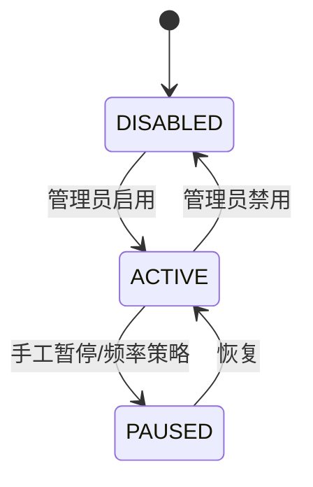
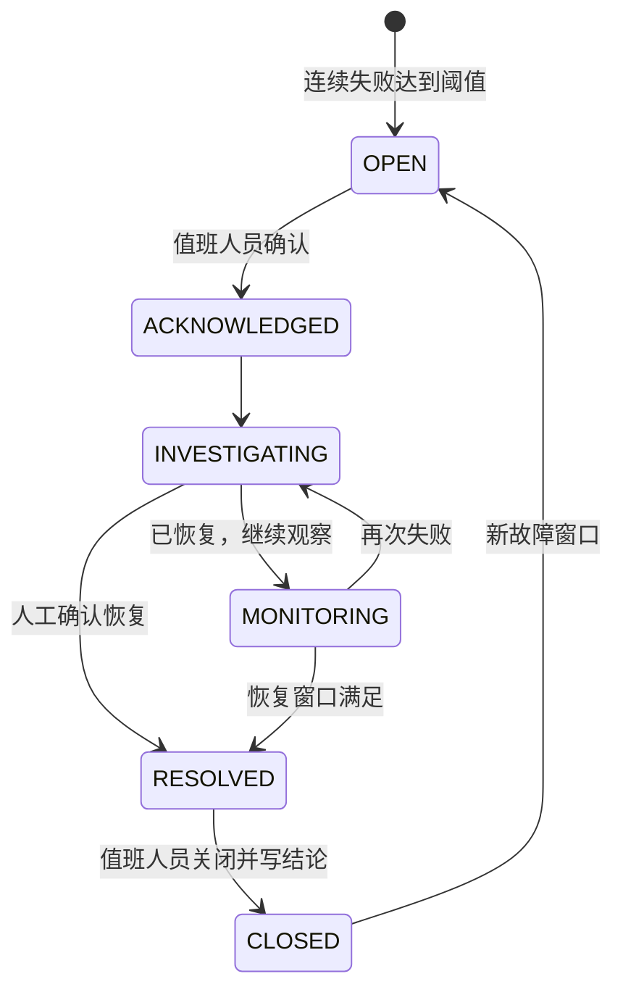
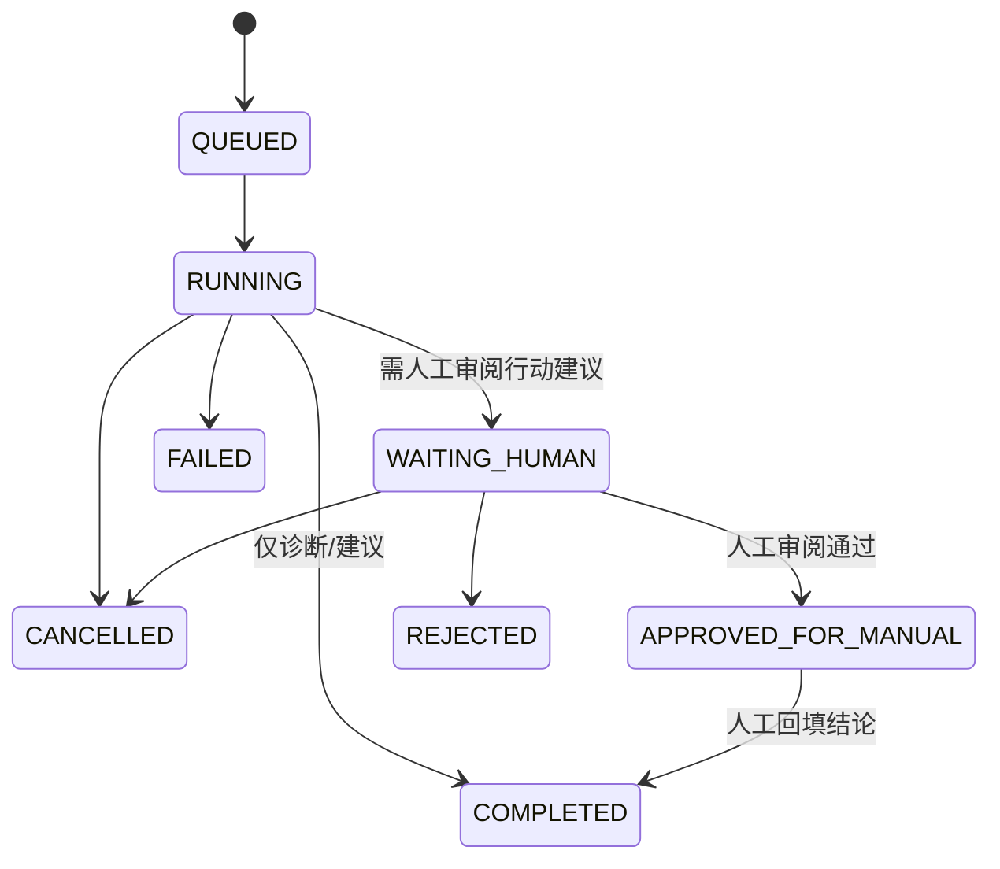

# 03｜领域模型与状态机

## 领域对象

- **ServiceTarget**：登记的服务/环境与所有者；标识可稳定引用，URL 由管理员配置。
- **CheckDefinition**：协议、间隔、超时、预期状态码、连续失败/成功阈值、启停状态。
- **CheckRun**：一次不可变执行记录；存状态、RTT、时间、脱敏错误分类，不存凭据和任意响应正文。
- **Incident**：服务故障事件聚合；有首次/最近失败时间、负责人、状态、原因候选和恢复时间。
- **Runbook**：授权的处理手册及不可变发布版本；每个发布版本拆成不可变 section，Agent 引用 `runbookId + version + sectionId`。编辑生成新版本和新 section UUID，旧引用继续可查。
- **AgentRun/AgentStep**：一次 LangGraph 诊断执行、线程 ID、节点状态、开始/结束、证据、输出摘要。
- **ApprovalRequest**：人对建议/手工操作计划的审阅记录；审批只表示人工允许继续查看/执行步骤，不代表平台执行命令。
- **IntegrationDelivery**：一个 checkRun 到一个 Kuma Push Monitor 的逻辑投递；`IntegrationDeliveryAttempt` 记录每次 HTTP 尝试、状态码和脱敏错误。

## 检查定义状态

## 事故状态机

每次故障窗口新建 incident；不得把已关闭事故静默改回 OPEN。恢复条件建议连续 2 次成功，须作为策略参数；初期由当前 `CheckDefinition` 版本冻结，避免中途改阈值改变历史含义。

## AgentRun 状态机

状态变更不可跳过；等待人工的审批请求 24 小时未决即转 `EXPIRED`，AgentRun 转 `CANCELLED`，不得再补批。审批前后保存输出 hash 与证据 ID。审批通过进入 `APPROVED_FOR_MANUAL`，不触发平台动作；操作者随后明确回填 `EXECUTED/NOT_EXECUTED/FAILED` 和说明，才转 `COMPLETED`。拒绝转 `REJECTED`。工具异常与模型失败分类存稳定错误码。

