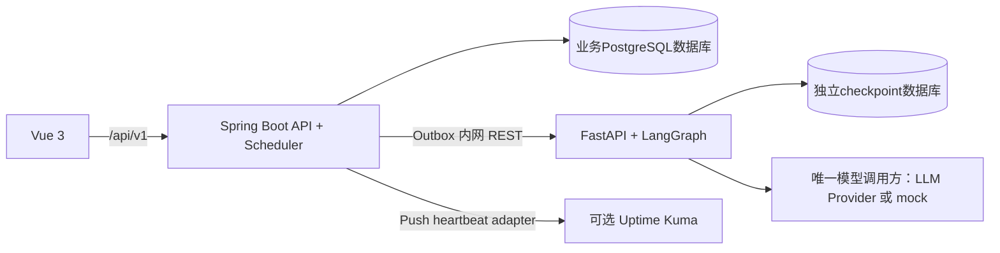

# 05｜架构与技术选型

## 拓扑

## 数据和控制流

Scheduler领取到期检查，访问已注册目标并保存CheckRun；聚合器达到失败阈值时创建incident。用户启动诊断时，Java验权并在同一事务创建AgentRun/Outbox；worker调Python内部API，传入授权incident、有限时间窗口的检查摘要、runbook版本和runId。当前Python图只读这些传入上下文，不直接读Java业务库；checkpoint以runId作为thread ID，结构化结果回Java核验保存。所有事故/审批写操作由Java API完成。

## 当前实现基线（2026-10-24核对）

| 层 | 选择 | 说明 |
|---|---|---|
| Java | Java 21、Spring Boot 4.1.x（观察到稳定版 4.1.1） | 业务主后端；当前补丁在 G0 复核 |
| Agent | Python3.13、FastAPI0.151.0、LangGraph1.2.16 | 实际锁定版本；FastAPI管内部REST，LangGraph管有状态图 |
| Web | Vue 3.5.x + TypeScript | 不采用 3.6 RC 作为稳定基线 |
| 数据库 | PostgreSQL17（Compose/测试17.11） | 业务与checkpoint数据库/角色分开；宿主机可共用PG实例，Compose使用独立PG容器 |
| 容器 | Docker Compose | Kuma 使用可选 profile；锁定明确版本/digest，不用 `latest` |

LangGraph 采用开源 Python 库和 Postgres checkpointer，不依赖 LangSmith/LangGraph Platform 云托管能力。**只有 Agent Service 调用模型**；Spring Boot 不连接模型。模型配置和密钥仅由 Agent Service 持有，provider 可插拔；`mock` 模式本地默认启用。

## 架构取舍

- **业务边界放在 Java**，符合目标岗位路线且确保权限/事务/审计集中。
- **Agent 独立 Python 服务**，利用 Python/LangGraph 表达图状态和节点；内部契约稳定、业务由 Java 决定。
- **PostgreSQL Outbox** 代替独立消息代理；单机部署轻量，同时保留至少一次投递。
- **服务探测走专用 scheduler**，只执行登记目标的轻量 HTTP GET/HEAD；不尝试复制 Prometheus、Zabbix 等完整监控平台。
- **Kuma 可选外部面板**，Push Token 用于单向状态投递；Push API 属于上游内部接口，故 adapter 需可关闭且做版本契约检查。

