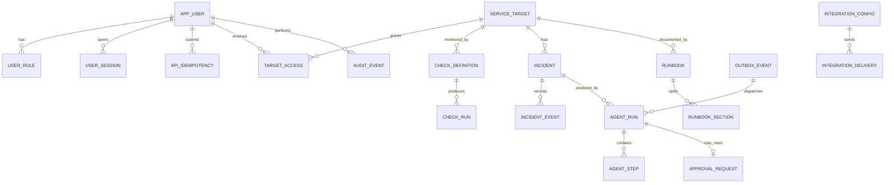

# 06｜数据模型 ERD 与 SQL

## ERD



## PostgreSQL DDL 基线

UUID 主键、UTC `timestamptz`、Flyway 增量迁移。secret 只存 secret reference 或应用层加密 ciphertext；下方省略密钥值。密码使用 Argon2id/bcrypt hash。

```sql
CREATE TABLE app_user (
  id uuid PRIMARY KEY, username varchar(80) UNIQUE NOT NULL,
  password_hash text NOT NULL, display_name varchar(120) NOT NULL,
  active boolean NOT NULL DEFAULT true, created_at timestamptz NOT NULL DEFAULT now()
);
CREATE TABLE app_role (
  id uuid PRIMARY KEY, code varchar(40) UNIQUE NOT NULL
    CHECK(code IN ('OBSERVER','ON_CALL','OPS_ADMIN','AUDITOR'))
);
CREATE TABLE user_role (
  user_id uuid REFERENCES app_user(id), role_id uuid REFERENCES app_role(id),
  PRIMARY KEY(user_id,role_id)
);
CREATE TABLE user_session (
  id uuid PRIMARY KEY, user_id uuid NOT NULL REFERENCES app_user(id),
  token_hash char(64) UNIQUE NOT NULL, expires_at timestamptz NOT NULL,
  revoked_at timestamptz, created_at timestamptz NOT NULL DEFAULT now()
);
CREATE TABLE api_idempotency (
  id uuid PRIMARY KEY, user_id uuid NOT NULL REFERENCES app_user(id),
  operation varchar(100) NOT NULL, idempotency_key varchar(128) NOT NULL,
  request_hash char(64) NOT NULL,
  state varchar(16) NOT NULL CHECK(state IN ('IN_PROGRESS','COMPLETED')),
  response_status smallint, response_resource_id uuid,
  created_at timestamptz NOT NULL DEFAULT now(), expires_at timestamptz NOT NULL,
  UNIQUE(user_id,operation,idempotency_key),
  CHECK((state='IN_PROGRESS' AND response_status IS NULL) OR
        (state='COMPLETED' AND response_status BETWEEN 200 AND 299))
);
CREATE INDEX api_idempotency_expiry_idx ON api_idempotency(expires_at);
CREATE TABLE service_target (
  id uuid PRIMARY KEY, code varchar(80) UNIQUE NOT NULL,
  name varchar(160) NOT NULL, environment varchar(40) NOT NULL,
  base_url text NOT NULL, owner_team varchar(120), active boolean NOT NULL DEFAULT true,
  network_policy varchar(24) NOT NULL DEFAULT 'PUBLIC_ONLY'
    CHECK(network_policy IN ('PUBLIC_ONLY','APPROVED_PRIVATE_CIDR')),
  created_by uuid NOT NULL REFERENCES app_user(id), created_at timestamptz NOT NULL DEFAULT now()
);
CREATE TABLE target_access (
  target_id uuid NOT NULL REFERENCES service_target(id),
  user_id uuid NOT NULL REFERENCES app_user(id),
  can_read boolean NOT NULL DEFAULT true,
  can_operate boolean NOT NULL DEFAULT false,
  PRIMARY KEY(target_id,user_id), CHECK(NOT can_operate OR can_read)
);
CREATE TABLE target_network_policy (
  id uuid PRIMARY KEY, target_id uuid NOT NULL REFERENCES service_target(id),
  version integer NOT NULL, allowed_private_cidrs cidr[] NOT NULL DEFAULT '{}',
  reason text NOT NULL, approved_by uuid NOT NULL REFERENCES app_user(id),
  approved_at timestamptz NOT NULL DEFAULT now(), active boolean NOT NULL DEFAULT true,
  UNIQUE(target_id,version)
);
CREATE TABLE check_definition (
  id uuid PRIMARY KEY, target_id uuid NOT NULL REFERENCES service_target(id),
  method varchar(8) NOT NULL CHECK(method IN ('GET','HEAD')),
  interval_seconds integer NOT NULL DEFAULT 60 CHECK(interval_seconds >= 60),
  timeout_ms integer NOT NULL DEFAULT 3000 CHECK(timeout_ms BETWEEN 100 AND 10000),
  expected_statuses int[] NOT NULL DEFAULT ARRAY[200],
  fail_threshold integer NOT NULL DEFAULT 3 CHECK(fail_threshold BETWEEN 1 AND 20),
  recover_threshold integer NOT NULL DEFAULT 2 CHECK(recover_threshold BETWEEN 1 AND 20),
  next_run_at timestamptz NOT NULL DEFAULT now(),
  state varchar(16) NOT NULL DEFAULT 'DISABLED'
    CHECK(state IN ('ACTIVE','PAUSED','DISABLED')),
  config_version integer NOT NULL DEFAULT 1, created_at timestamptz NOT NULL DEFAULT now()
);
CREATE TABLE check_run (
  id uuid PRIMARY KEY, check_definition_id uuid NOT NULL REFERENCES check_definition(id),
  started_at timestamptz NOT NULL, completed_at timestamptz NOT NULL,
  outcome varchar(16) NOT NULL CHECK(outcome IN ('UP','DOWN','UNKNOWN')),
  status_code integer, latency_ms integer, error_code varchar(80),
  idempotency_key varchar(160) UNIQUE NOT NULL
);
CREATE TABLE incident (
  id uuid PRIMARY KEY, target_id uuid NOT NULL REFERENCES service_target(id),
  status varchar(24) NOT NULL DEFAULT 'OPEN'
    CHECK(status IN ('OPEN','ACKNOWLEDGED','INVESTIGATING','MONITORING','RESOLVED','CLOSED')),
  severity varchar(16) NOT NULL DEFAULT 'P2' CHECK(severity IN ('P1','P2','P3','P4')),
  opened_at timestamptz NOT NULL DEFAULT now(), acknowledged_by uuid REFERENCES app_user(id),
  resolved_at timestamptz, closed_at timestamptz, summary text,
  version bigint NOT NULL DEFAULT 0
);
CREATE UNIQUE INDEX ux_incident_open_per_target ON incident(target_id)
  WHERE status IN ('OPEN','ACKNOWLEDGED','INVESTIGATING','MONITORING');
CREATE TABLE incident_event (
  id uuid PRIMARY KEY, incident_id uuid NOT NULL REFERENCES incident(id),
  actor_id uuid REFERENCES app_user(id), event_type varchar(80) NOT NULL,
  body text, metadata jsonb NOT NULL DEFAULT '{}', created_at timestamptz NOT NULL DEFAULT now()
);
CREATE TABLE runbook (
  id uuid PRIMARY KEY, target_id uuid REFERENCES service_target(id),
  title varchar(200) NOT NULL, version integer NOT NULL,
  body_markdown text NOT NULL, state varchar(16) NOT NULL CHECK(state IN ('DRAFT','PUBLISHED','DISABLED')),
  created_by uuid NOT NULL REFERENCES app_user(id), created_at timestamptz NOT NULL DEFAULT now(),
  UNIQUE(target_id,title,version)
);
CREATE TABLE runbook_section (
  id uuid PRIMARY KEY, runbook_id uuid NOT NULL REFERENCES runbook(id),
  section_key varchar(160) NOT NULL, heading_path text NOT NULL,
  content text NOT NULL, content_sha256 char(64) NOT NULL,
  UNIQUE(runbook_id,section_key)
);
CREATE TABLE agent_run (
  id uuid PRIMARY KEY, incident_id uuid NOT NULL REFERENCES incident(id),
  requested_by uuid NOT NULL REFERENCES app_user(id), graph_version varchar(80) NOT NULL,
  thread_id varchar(160) UNIQUE NOT NULL,
  status varchar(24) NOT NULL DEFAULT 'QUEUED'
    CHECK(status IN ('QUEUED','RUNNING','WAITING_HUMAN','APPROVED_FOR_MANUAL','REJECTED','COMPLETED','FAILED','CANCELLED')),
  result_json jsonb, error_code varchar(80), manual_action_report jsonb,
  manual_action_recorded_by uuid REFERENCES app_user(id), manual_action_recorded_at timestamptz,
  created_at timestamptz NOT NULL DEFAULT now(),
  updated_at timestamptz NOT NULL DEFAULT now()
);
CREATE TABLE agent_step (
  id uuid PRIMARY KEY, agent_run_id uuid NOT NULL REFERENCES agent_run(id),
  node_name varchar(100) NOT NULL, state varchar(16) NOT NULL,
  input_hash char(64), evidence_ids jsonb NOT NULL DEFAULT '[]', output_summary text,
  started_at timestamptz, completed_at timestamptz
);
CREATE TABLE approval_request (
  id uuid PRIMARY KEY, agent_run_id uuid NOT NULL UNIQUE REFERENCES agent_run(id),
  status varchar(16) NOT NULL CHECK(status IN ('PENDING','APPROVED','REJECTED','EXPIRED')),
  requested_by uuid NOT NULL REFERENCES app_user(id), decided_by uuid REFERENCES app_user(id),
  decision_reason text, decision_at timestamptz
);
CREATE TABLE integration_config (
  id uuid PRIMARY KEY, integration_type varchar(32) NOT NULL,
  base_url text NOT NULL, secret_ref text NOT NULL,
  target_id uuid NOT NULL REFERENCES service_target(id), enabled boolean NOT NULL DEFAULT false,
  last_delivery_at timestamptz, last_delivery_state varchar(24),
  UNIQUE(integration_type,target_id)
);
CREATE TABLE integration_delivery (
  id uuid PRIMARY KEY, integration_id uuid NOT NULL REFERENCES integration_config(id),
  check_run_id uuid NOT NULL REFERENCES check_run(id),
  state varchar(16) NOT NULL CHECK(state IN ('PENDING','DELIVERED','FAILED','DEAD')),
  attempts integer NOT NULL DEFAULT 0, last_http_status integer,
  last_error_code varchar(80), last_attempt_at timestamptz,
  created_at timestamptz NOT NULL DEFAULT now(),
  UNIQUE(integration_id,check_run_id)
);
CREATE TABLE integration_delivery_attempt (
  id uuid PRIMARY KEY, delivery_id uuid NOT NULL REFERENCES integration_delivery(id),
  attempt_no integer NOT NULL, http_status integer, error_code varchar(80),
  attempted_at timestamptz NOT NULL DEFAULT now(),
  UNIQUE(delivery_id,attempt_no)
);
CREATE TABLE outbox_event (
  id uuid PRIMARY KEY, event_type varchar(120) NOT NULL, aggregate_id uuid NOT NULL,
  payload jsonb NOT NULL, state varchar(16) NOT NULL DEFAULT 'PENDING', attempts int NOT NULL DEFAULT 0,
  available_at timestamptz NOT NULL DEFAULT now(), locked_until timestamptz, last_error_code varchar(80)
);
CREATE TABLE audit_event (
  id uuid PRIMARY KEY, actor_id uuid REFERENCES app_user(id), action varchar(100) NOT NULL,
  subject_type varchar(80) NOT NULL, subject_id uuid, request_id varchar(100),
  metadata jsonb NOT NULL DEFAULT '{}', created_at timestamptz NOT NULL DEFAULT now()
);
CREATE INDEX ix_check_due ON check_definition(state,interval_seconds,target_id);
CREATE INDEX ix_check_next_run ON check_definition(next_run_at) WHERE state='ACTIVE';
CREATE INDEX ix_target_access_user ON target_access(user_id,target_id);
CREATE UNIQUE INDEX ux_target_network_policy_active ON target_network_policy(target_id) WHERE active;
CREATE INDEX ix_check_run_history ON check_run(check_definition_id,completed_at DESC);
CREATE INDEX ix_incident_recent ON incident(status,opened_at DESC);
CREATE INDEX ix_agent_run_incident ON agent_run(incident_id,created_at DESC);
CREATE INDEX ix_outbox_ready ON outbox_event(available_at) WHERE state='PENDING';
CREATE INDEX ix_integration_delivery_retry ON integration_delivery(state,created_at);
CREATE INDEX ix_audit_subject_time ON audit_event(subject_type,subject_id,created_at DESC);
```

## DDL 实施注意

- Outbox state 的合法值应由迁移约束补齐 `PENDING/DELIVERED/DEAD`；payload 只含 ID 和非敏感摘要。
- 目标 URL 修改生成新配置版本和审计事件；每次探测保存实际解析 IP/redirect decision 作为安全审计摘要，不保存认证 header。
- LangGraph checkpoint 用独立 schema/账号；仅 Python agent 服务可读写。checkpoint 序列化不得存明文 token 或过量日志。
- `integration_config.secret_ref` 指向外部 secret store，若本地版使用加密字段则加密密钥不能与数据库卷放在一起。
- 用户 bearer session 为随机不透明 token，后端保存带 pepper hash；30 分钟过期、不提供 refresh，前端仅内存保存，logout 撤销当前 session。
- G1 的登录用户读取使用事务内 `FOR SHARE`，与停用用户的 `FOR UPDATE` 串行，避免停用撤销后又插入可复活的会话。用户管理的停用/角色覆盖使用相同事务 advisory lock，禁止移除最后活跃 OPS_ADMIN。
- G1 用户创建的幂等指纹覆盖密码但必须用数据库外 pepper 的 HMAC-SHA256；不得使用无密钥摘要形成额外的廉价密码校验器。`request_hash char(64)` 字段可保存该指纹，无需储存请求正文。
- 所有目标级资源（检查历史、事故、运行手册和 AgentRun）沿用 `target_access`；`OPS_ADMIN` 可配置但操作须审计；`AUDITOR` 全局只读审计元数据，目标正文仍需 `target_access.can_read`。
- 私网策略必须有逐目标版本化的 CIDR 白名单、批准人和理由。请求解析出的每个 IP 都要属于显式 CIDR；metadata、loopback、link-local 和 multicast 永远拒绝，不能通过白名单覆盖。`APPROVED_PRIVATE_CIDR` 仅表示存在 active policy，不代表放开所有私网。
- 运行手册版本不可变；每个发布版本的 section 有稳定 UUID，`sectionId` 只在该版本内有效。编辑生成新版本/新 section ID，旧 AgentRun 引用继续可查。
- `integration_delivery` 以 `(integration_id,check_run_id)` 幂等，attempt 子表保存每次状态码/脱敏错误；不得保存 token URL。

G5已落地的DDL以不可变迁移 `V6__kuma_delivery.sql` 为准：config按target唯一、含version/smoke_passed/集成租约与轮询游标；secret_ref限定env:KUMA_PUSH_TOKEN_*，不存token。delivery区分CHECK/SMOKE，CHECK引用check_run并唯一，SMOKE不引用检查；状态PENDING/DELIVERED/DEAD/SUPERSEDED，含available_at与有界attempts。每集成只允许一个待发送smoke；attempt子表保存每次已完成尝试，不记录正文。上述概念DDL用于设计说明，不应手工执行替代Flyway。

