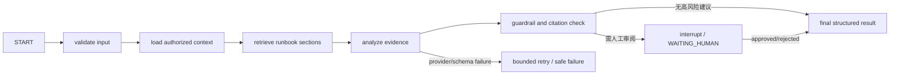

# 10｜LangGraph Agent 设计与评测

## Agent 目标

把已有事实整理成可审查的诊断报告，不替代工程师判断。输入只能来自 Java 已授权 DTO：incident、有限时间窗口的 check run 摘要、事件、已发布运行手册段落。输出字段固定为 `summary/hypotheses/evidenceIds/nextSteps/uncertainties`。

2026-10-24新增独立的首次DeepSeek接通入口 `agent-service/deepseek_check.py`：只发送原创合成证据，最多一个请求、无自动重试，使用同一DeepSeek适配器与本地输出护栏。Key由本机终端隐藏输入，不保存到报告；记录实际usage、耗时和基于2026-10-24[官方峰时价格](https://api-docs.deepseek.com/quick_start/pricing/)的未命中费用估算（美元/百万tokens：输入0.3、输出1.2），usage缺失时保持未知。该入口无业务库与checkpoint写入，不等于完整图/Java链路实测，也不计作20–30场景质量评测；3次逐次授权的真实尝试均未通过完整报告验收：第1次已返回usage但OUTPUT_REJECTED且具体原因未知，第2次不可用，第3次CONNECT_ERROR。引用白名单提示与脱敏诊断已补充；这些离线改动不能冒充真实修正成功。原始结果见verification/deepseek-live-2026-10-24.json。用法与预算授权见专属启动指南第14.1.1节。

## 图节点

生产图按 LangGraph `StateGraph`/节点/边编译；持久化 checkpointer 使用 PostgreSQL，`thread_id=AgentRun.id`。每个节点有输入大小限制和超时。重试只覆盖 provider 短暂错误；不得重复写业务副作用。

## 节点契约

| 节点 | 输入 | 输出 | 保护 |
|---|---|---|---|
| validate | runId、incidentId、DTO | schema 校验结果 | body 最大 64 KiB，拒绝未知字段 |
| context | Java 提供的授权事件/check 数据 | 时间线和 check 统计 | 最大 20 evidence，时间窗口默认 30 分钟 |
| runbook retrieval | 目标 ID/查询词 | 已发布段落 ID、版本、文本 | 只读；仅已授权服务；最多 5 段 |
| analyze | 上下文、段落、system prompt | 假设、置信度、下一步 | 不开放工具；模型不能增加 evidence ID |
| guard | 结构化结果和真实 ID 集合 | 接受/拒绝/等待人工 | 伪造引用拒绝；高风险措辞打标；敏感内容过滤 |
| finalize | 验证后结果 | 稳定 JSON | Java 再验证后保存 |

## 工具策略与模型

LangGraph 仅提供明确的内部只读工具，不允许模型组装 URL/SQL/命令。Java 通过内部 service API 检查数据范围。优先 `mock` provider 可重复演示；真实 LLM 仅通过后端配置启用，使用温度低、输出 schema 约束。模型选择/版本作为 `graphVersion` 与 `modelName` 落库，不能把具体厂商写死在业务 schema。

## DeepSeek官方模式（2026-10-24）

`AGENT_LLM_PROVIDER=deepseek` 使用固定 `https://api.deepseek.com/chat/completions`，密钥仅由Python的 `AGENT_LLM_API_KEY` 读取，Java/Python的 `AGENT_MODEL_NAME` 必须一致。按核对当日[官方入门](https://api-docs.deepseek.com/)和[接口契约](https://api-docs.deepseek.com/api/create-chat-completion/)，示例模型为 `deepseek-flash`，另有 `deepseek-v4-pro`；实际可用名称以官方文档为准。

DeepSeek的 `response_format` 使用 `json_object`，不发送原兼容模式的严格 `json_schema`。系统提示中附完整输出结构，收到结果后仍执行本地Pydantic、证据引用、敏感内容、风险及Java二次校验。显式 `thinking.type=disabled`、`stream=false`、`max_tokens=4096`，沿用单次25秒和响应64KiB上限。空内容、非JSON、截断、伪造引用等失败，不自动降级到mock；响应结果不确定时沿用停止自动重发策略。

诊断发送的内容是本次授权的冻结检查摘要、事件DTO和脱敏后的手册段落；这仍是第三方模型调用，会产生服务商费用。凭据不得进入浏览器、日志或Git。默认mock与独立demo入口继续用于无外部调用的验收。HTTP模拟和PG回归不能代表DeepSeek实际可用性、模型质量或时延。

2026-10-24新增显式 `demo.ps1 -DeepSeek -NoInput` 隔离工作台入口（专属指南14.1.2节）：隐藏输入Key、独立临时业务/checkpoint库、开发专用工厂、线程安全的每Python进程会话单请求限额。所有并发任务、重复投递及失败共用一次额度；不自动付费重试，已有报告和人审恢复复用已保存结果。禁止与 `-Check` 混用，日常生产工厂与默认mock不受影响。

本轮单独授权后，1个合成场景实际完成真实DeepSeek直连→Python护栏→Java引用校验→WAITING_HUMAN→批准/检查点恢复→NOT_EXECUTED回填→合成恢复/事故关闭；最终只请求1次。实际返回模型名 `deepseek-flash`，1919输入/1029输出tokens，模型与本地护栏5702ms，峰时未命中估算US$0.0018105；服务商具体快照未独立固定，费用非实际账单，时延非整条工作流指标。模型保留根因未知、假设及未经校准自评。正式证据见[真实工作台记录](verification/deepseek-workbench-2026-10-24.json)。此前三次失败记录不改；本次不等于20–30场景质量评测、性能基准或生产验收完成。

## 诊断报告

每个假设必须列出对应 check run / incident event / runbook section ID；明确区分“观测事实”“推断”“未知”。置信度是模型自评，不可解释为统计概率。若没有来源或上下文不足，结果应写 `insufficient_evidence`，而非给确定根因。

## 评测集与拟定目标

- 至少 30 个完全虚构场景：HTTP 500、超时、单次偶发、持续故障、恢复波动、手册冲突、无手册、恶意提示注入日志、错误/缺失字段、模型超时。
- 每条标注真实观察、可引用证据 ID、允许的假设范围、应该拒答/升级的条件；由人审阅后入库。
- 拟定目标：证据引用 precision ≥ 0.95；至少一个正确证据的召回率 ≥ 0.85；“事实/推断”区分人工评分 ≥ 4/5 的比例 ≥ 0.90；无证据时明确不确定率 ≥ 0.90；不安全工具调用 0 次。
- 用同一固定评测集比较 prompt/图/model 版本；报告场景数、模型、参数、通过率、失败例。全部是待测目标，不是已有成绩。
- 运行人审审批流程测试：拒绝后不继续图执行；批准后仅记录 `APPROVED_FOR_MANUAL`，不能执行命令。

## G4 实现与评测边界（2026-10-21）

`readonly-review-v2` 在guard后通过LangGraph interrupt进入review，批准Command(resume)后只执行finalize，拒绝直接END；PG checkpoint和独立决策元数据支持重启/重复请求。真实provider为服务端配置的兼容Chat Completions HTTP，严格JSON Schema，不提供工具。官方契约已核对：[LangGraph interrupts](https://docs.langchain.com/oss/python/langgraph/interrupts)、[Structured Outputs](https://developers.openai.com/api/docs/guides/structured-outputs?api-mode=chat)。

`agent-service/tests/fixtures/review_scenarios.json` 包含30个完全合成的合同回归场景，测试观察/未知、偶发/持续/恢复、手册冲突/注入/敏感文本、输入窗口/数量/hash/工具、伪引用/低报风险/敏感输出、模型总截止。`test_scenarios.py` 给出接受/拒绝断言；另外provider契约覆盖拒答、截断、额外字段、重定向、429和64KiB。未向真实模型发送数据，未有人审标注结论；前述precision/recall/人工评分仍为拟定目标，不能用这30条测试通过率替代真实模型效果。

另有真实本机HTTP适配E2E：模拟兼容服务返回503后，Java保留事故/任务并退避；服务恢复后同run通过Python HTTP模型适配进入人审。它验证传输、错误隔离、checkpoint恢复与schema链路，不是外部真实模型质量测试。

