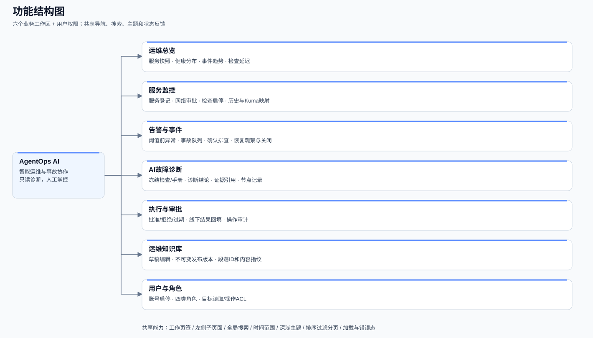
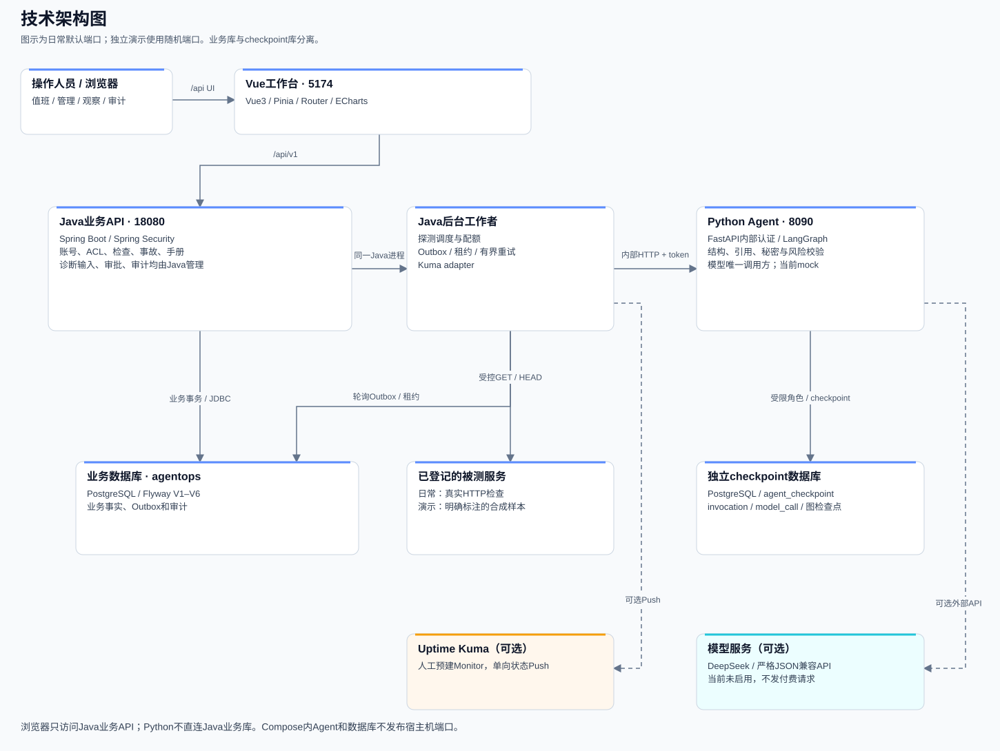
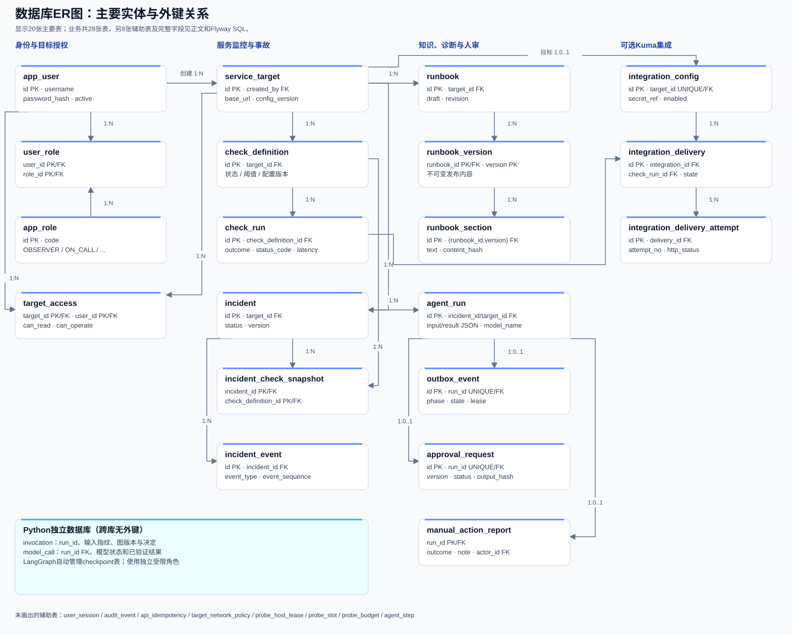
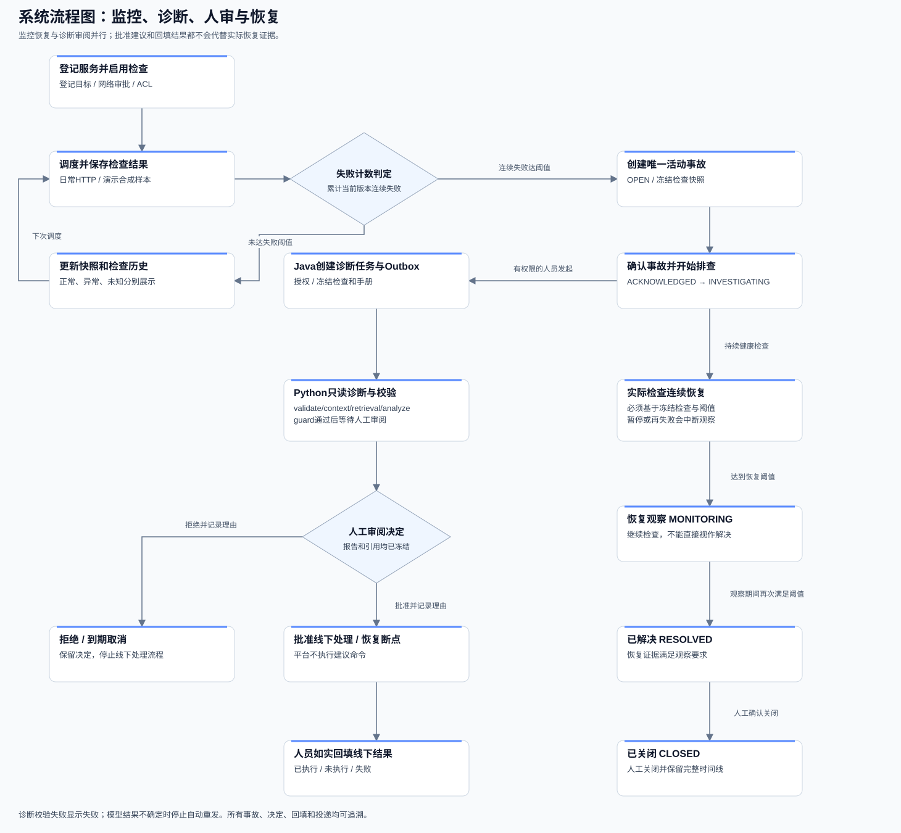

# Dawnwatch 项目详细说明

更新日期：2026-10-24。本文根据当前仓库代码、依赖锁、Flyway迁移和实际验证记录整理。代码基线为 `56b182f`，当前改名分支为 `codex/dawnwatch-rename`，基于已完成的 DeepSeek 适配成果。本文不包含密码、密钥或带凭据的数据库连接串。

本文配有功能结构图、技术架构图、数据库ER图和系统流程图。图为本地SVG，可点击放大；[离线图文版](docs/project-overview/项目详细说明.html)可在浏览器中直接打开，不依赖外部脚本或网络。详细启动步骤仍以[专属IDEA启动与验收指南](IDEA启动与验收指南.md)为准。

## 1. 项目是什么

Dawnwatch 是面向值班人员、运维管理员和审计人员的轻量运维协作平台。它围绕一条处理链路组织功能：**登记服务 → 持续健康检查 → 聚合事故 → 整理诊断证据 → 人工审阅 → 线下处理回填 → 检查恢复 → 人工关闭**。

平台保存检查和处理事实，AI负责整理已授权证据并提出建议。当前MVP没有shell、SSH、SQL写入、kubectl或自动修复工具。批准AI建议表示允许人员在线下处理，并不会由平台执行命令。

当前运行选择为 **mock**：可体验完整业务流程，不请求DeepSeek、不需要模型Key。DeepSeek官方API适配已经实现，但真实可用性、效果和费用需在用户明确配置后另行验收。

## 2. 功能结构图与模块



| 模块 | 已实现能力 | 使用重点 |
|---|---|---|
| 运维总览 | 服务数量、正常/异常/未知分布、活动事故、事件趋势、检查延迟与最近事件 | 状态快照与时间范围内的历史统计分别显示，未知不算正常 |
| 服务监控 | 目标登记、ACL、网络策略、GET/HEAD检查、启停、检查历史、Kuma配置 | 新检查默认禁用；私网和HTTP需显式审批 |
| 告警与事件 | 阈值前异常进度、事故列表、确认/排查/恢复观察/解决/关闭、事件时间线 | 同目标只允许一个活动事故，恢复不会跳过人工处理步骤 |
| AI故障诊断 | 诊断任务、冻结证据、运行手册引用、结构化结论、假设、节点记录、不确定项 | 结论与证据可核对；mock不冒充真实模型调用 |
| 执行与审批 | 待审阅/待线下处理筛选、批准/拒绝、到期取消、结果回填 | 回填执行、未执行或失败，不直接改变事故恢复状态 |
| 运维知识库 | 手册草稿、编辑冲突检测、发布不可变版本、段落ID和内容指纹 | 新版或停用手册不改变旧报告引用 |
| 用户与角色 | 登录/退出、会话、账号启停、角色管理、目标级读取/操作授权 | 管理员身份不自动等于值班操作权限 |

共享工作空间提供深浅主题、搜索、时间范围、列表排序/过滤/分页、工作页签、侧栏子页面、详情页主要动作、返回上下文和错误/空态/加载态。实时效果来自定时查询实际记录，不生成随机监控曲线。

### 角色与授权

| 角色代码 | 中文含义 | 主要范围 |
|---|---|---|
| `OBSERVER` | 观察员 | 读取被授权服务、检查和事件；不能执行处理 |
| `ON_CALL` | 值班人员 | 在目标具备 `can_operate` 时处理事故、发起诊断和人审 |
| `OPS_ADMIN` | 运维管理员 | 管理账号、角色、服务及集成配置；事故处理仍需值班角色与操作ACL |
| `AUDITOR` | 审计人员 | 按权限核对诊断和处理记录，不代表拥有管理或处置权限 |

账号可以拥有多个角色。角色和目标ACL由Java统一核验，前端隐藏按钮不替代服务端权限检查。

## 3. 技术架构图



### 各服务职责

- **Vue工作台**：渲染总览、服务、事件、诊断和审批页面；通过同源 `/api/v1` 调Java。
- **Java后端**：身份、ACL、服务、检查、事故、知识版本、审批、审计的事实来源；负责探测调度和Outbox投递。
- **Python Agent**：只接收带内部服务认证的受控输入，使用LangGraph整理检查与手册，保存checkpoint和模型调用结果。
- **业务PostgreSQL**：保存Java管理的业务实体，Flyway迁移当前为V1–V6。
- **独立checkpoint PostgreSQL数据库**：保存Python调用元数据、模型结果和LangGraph检查点；可与业务库处于同一PG服务实例，但数据库与应用角色分开。Compose中使用独立PG容器。
- **模型provider**：Python是唯一模型调用方。支持mock、严格JSON Schema兼容服务及DeepSeek官方JSON Output模式。
- **Uptime Kuma（可选）**：接收Dawnwatch单向Push状态；不承担核心检查和事故事务，也不自动导入或创建Monitor。

Python当前使用Java发送的授权检查摘要和已发布手册上下文，不直接读取Java业务库，也不接受模型自行选择任意地址或命令。浏览器不直连内部Agent接口。

### 当前技术版本

以下是仓库锁定值，不是“上游最新版本”的声明。

| 层 | 实际配置 |
|---|---|
| Java / Maven | Java21；Maven3.9系列；后端版本 `0.1.0-SNAPSHOT` |
| Spring Boot | `4.1.1`，Tomcat `11.0.27`，Jackson BOM `3.1.8` |
| Python | `3.13`，运行和开发依赖均有带哈希的锁文件 |
| FastAPI / Uvicorn | `0.151.0` / `0.54.0` |
| LangGraph / PG checkpointer | `1.2.16` / `3.2.0` |
| Pydantic / HTTPX | `2.14.1` / `0.28.1` |
| 数据库 | PostgreSQL17；Compose和隔离测试固定 `17.11` |
| Vue / TypeScript / Vite | `3.5.44` / `5.9.3` / `8.3.4` |
| 状态与路由 | Pinia `4.1.0`，Vue Router `4.6.4` |
| 样式与共享组件 | Tailwind CSS `4.3.3`；本地shadcn风格组件，交互基于reka-ui `2.11.0` |
| 图表与图标 | Apache ECharts `6.1.0`，Lucide Vue `1.61.0` |
| 可选监控面板 | Uptime Kuma `2.3.0`，镜像有固定摘要 |

核对入口：[后端依赖](backend/pom.xml)、[Python运行锁](agent-service/requirements.lock)、[前端依赖](frontend/package.json)、[Compose](compose.yaml)。

## 4. 数据库设计图



图中显示20张主要业务表的关系，`1:N` 表示一对多，`1:0..1` 表示最多一个关联对象，PK/FK分别是主键/外键。为保持可读性，图未展开全部列，也省略了8张会话、审计、幂等和调度等辅助表。业务库总计28张建表定义；完整字段、索引和约束以[数据库设计](docs/06-数据模型ERD与SQL.md)和[实际迁移](db/migration)为准。

### 业务表清单

| 分组 | 实际表名 | 主要用途 |
|---|---|---|
| 身份 | `app_user`、`app_role`、`user_role`、`user_session` | 账号、角色、多角色关系、会话哈希与到期/撤销 |
| 审计和幂等 | `audit_event`、`api_idempotency` | 操作追溯、请求指纹和幂等结果 |
| 目标与策略 | `service_target`、`target_access`、`target_network_policy` | 目标、读取/操作ACL、版本化网络审批 |
| 探测调度 | `probe_host_lease`、`probe_slot`、`probe_budget` | 域名租约、并发槽、全局预算 |
| 检查 | `check_definition`、`check_run` | 检查参数、配置版本、连续计数、不可变执行结果 |
| 事故 | `incident`、`incident_check_snapshot`、`incident_event` | 状态和版本、冻结检查/恢复阈值、时间线 |
| 运行手册 | `runbook`、`runbook_version`、`runbook_section` | 草稿、不可变发布版本、稳定段落和SHA-256 |
| 诊断 | `agent_run`、`agent_step`、`outbox_event` | 冻结输入、报告与节点、可靠异步投递 |
| 人工流程 | `approval_request`、`manual_action_report` | 审阅版本/决定/时限、实际线下结果 |
| Kuma集成 | `integration_config`、`integration_delivery`、`integration_delivery_attempt` | 映射与secret引用、投递状态、尝试记录 |

### 关键约束

1. `target_access` 约束“可操作必须同时可读”。
2. 活动事故使用按目标的部分唯一索引，避免同一目标同时出现多个活动事故。
3. 检查结果绑定检查与目标配置版本，迟到结果不能覆盖新配置事实。
4. 手册版本使用复合主键；段落保留稳定ID与内容哈希，诊断输入冻结当时的引用。
5. 每个诊断任务最多一个审阅请求和一份线下处理结果；重复请求按版本、幂等键和指纹处理。
6. Outbox在创建诊断事实的同一事务中落库，通过租约与有限重试投递，不宣称跨系统严格只执行一次。

### Python独立库

Python在独立库的 `agent_checkpoint` schema中维护 `invocation`（输入指纹、图版本和决定）及 `model_call`（STARTED/COMPLETED/RETRYABLE和已验证结果）；LangGraph的checkpoint表由固定版本checkpointer管理。`runId` 与Java的诊断ID一致，但跨数据库没有外键。

启动时会拒绝超级用户/可建库或建角色的checkpoint角色，并拒绝把包含Java业务表的数据库当checkpoint库。模型结果先持久化，再继续图检查点；遇到远端结果不确定时停止自动重发。

## 5. 系统流程图



### 监控与事故

服务登记后创建检查，显式启用才会执行。检查默认面向公网HTTPS；HTTP与私网访问要经过部署范围和目标审批两层约束。调度器重新验证DNS，固定连接IP，记录状态码、延迟、错误码和解析地址。

连续失败达到阈值才创建事故。基本事故状态为：

`OPEN → ACKNOWLEDGED → INVESTIGATING → MONITORING → RESOLVED → CLOSED`

恢复观察仍以冻结检查再次满足阈值为依据；恢复过程中再次异常或暂停检查会中断观察。诊断完成、人审通过和回填未执行都不代表事故已恢复。

### 诊断与人工处理

1. Java核验值班角色及目标操作授权，冻结检查和手册，写入AgentRun与Outbox。
2. 后台工作者通过内部HTTP把任务交给Python，同一 `runId` 幂等处理。
3. 图执行 `validate/context/retrieval/analyze/guard`，结果通过结构、引用、敏感内容和风险检查后等待人审。
4. 人工批准或拒绝，决定在Java持久化并经Outbox同步Python断点。拒绝不会进入线下回填；审阅默认24小时到期。
5. 批准后进入 `APPROVED_FOR_MANUAL`。人员实际线下处理后回填 `EXECUTED/NOT_EXECUTED/FAILED`，保留审计。

所有正常和失败分支都保留明确任务状态。不存在根据动画推测Agent正在执行命令的行为；节点确认来自已保存结果。

## 6. 安全与可靠性边界

- 会话使用不透明Bearer token，服务端保存HMAC摘要，密码保存bcrypt hash；前端token仅在当前页面内存中，刷新需要重新登录。
- 内部服务token和模型Key仅在服务端；Git忽略本机 `.env`、`.idea`、缓存与依赖。
- 探测禁止任意内网扫描、云元数据和保留地址，不跟随重定向；限制方法、响应体、总超时和并发/域名配额。
- 运行手册和检查信息是待分析数据，不能成为覆盖系统边界的指令。模型没有运维写工具。
- 模型HTTP调用上限25秒、响应64KiB；DeepSeek模式为JSON Output、非思考、非流式和4096输出tokens。
- 不确定模型调用结果会返回 `AGENT_MODEL_OUTCOME_UNKNOWN`，需要核对服务商记录后明确决定是否发起新任务。
- Kuma失败不回滚或丢失核心检查和事故，过期/未知样本不作为正常状态推送。

## 7. 目录结构

```text
Dawnwatch/
├─ backend/                  Java业务与调度、API、集成及测试
├─ agent-service/            Python内部API、LangGraph、模型适配及测试
├─ frontend/                 Vue工作台、共享组件及前端回归
├─ db/migration/             Flyway V1–V6
├─ deploy/                   部署辅助配置与数据库初始化
├─ scripts/                  启动、验收、演示、依赖和恢复脚本
├─ docs/                     01–16专项设计与正式验证摘要
│  ├─ project-overview/      本文四类SVG图及离线图文版
│  └─ verification/          脱敏阶段结果、必要截图与依赖资料
├─ .github/workflows/        Java/Python、前端和Compose流水线
├─ .tools/、.cache/           本地运行时、依赖与临时产物，不提交
├─ IDEA启动与验收指南.md      日常操作入口
├─ 项目详细说明.md            项目信息入口（本文）
└─ README.md                仓库入口
```

## 8. 启动方式与端口

| 环境 | 前端 | Java | Python | 数据和用途 |
|---|---|---|---|---|
| 日常IDEA | 5174 | 18080 | 8090 | 已有业务/独立checkpoint数据库，配置由本机维护 |
| 独立演示 | 随机本机端口 | 随机本机端口 | 随机本机端口 | 临时PG、随机账号、预建服务和手册，默认mock，最长两小时 |
| Compose | 默认5174 | 默认18080 | 容器内部8090 | 独立业务/checkpoint数据卷，Kuma按需启用 |

### 快速查看完整项目

```powershell
Set-Location 'E:\javaProjects\AgentOps AI'
.\scripts\demo.ps1
```

打开本次终端打印的网址，使用本次随机账号。`down/up/status/quit` 分别注入故障/恢复、查看状态和结束会话。演示样本为合成503/200，业务聚合、Outbox、Python checkpoint和人审流程实际运行；它不探测外部网站，也不调用真实模型。结束后数据清除，重要内容不要保存在演示环境。

日常启动详见指南第2节；一键代码回归见第12节；演示见第13节；DeepSeek配置见第14节。默认使用mock模式；DeepSeek适配已提供，真实模型运行与效果尚未验收。

## 9. 实际验证进度

| 验证记录 | 实际结果 | 范围和限制 |
|---|---|---|
| G6完整本地回归，2026-10-23 | Java129、Python59、前端10、目标/会话9、报告5；共212项，类型/构建通过 | 属于5.1兼容修正基线，不能冒充后续所有改动的全套结果 |
| DeepSeek适配，2026-10-24 | Python74项；定向Java15项（包含Python真实PG12项）通过 | 使用模拟HTTP，不是真实DeepSeek效果；未重跑完整Java129和前端 |
| 独立演示 | 故障→确认排查→诊断→人审→未执行回填→恢复→关闭的7步自检通过 | 合成探测样本、mock模型；临时数据库与实际业务流程 |
| 首次GitHub CI | 历史提交39c1948的Java/前端/Compose任务已核实成功 | 新分支不能沿用旧提交绿灯；本文未重新查询最新CI |

详细证据见[测试矩阵与阶段门](docs/13-测试矩阵与阶段门.md)。文档整理和启动健康检查不是新增功能回归；没有把未运行的模型评分或性能指标写成成绩。

## 10. 当前限制与后续工作

1. 真实DeepSeek可用性、输出质量、耗时和实际用量尚未验收，默认继续mock。
2. 完整容量/并发性能指标、长期运行和完整OS供应链扫描仍需专项实测。
3. G6演示与模型适配不是自动修复功能，也不是覆盖全部基础设施的监控平台。
4. 自定义服务探测需要先登记并满足网络策略；独立演示不能替代真实HTTP探测验收。
5. 当前改名分支基于DeepSeek适配成果继续开发，尚未合并到main；阶段结果独立验证，合并按用户Git实操计划推进。Compose用户先阅读部署文档中的数据卷兼容说明。

## 11. 继续阅读

- [IDEA启动与验收指南](IDEA启动与验收指南.md)：启动、日常账号使用、模型配置和验收操作。
- [项目章程与PRD](docs/01-项目章程与PRD.md)、[角色需求](docs/02-角色用例与需求.md)：产品范围与使用角色。
- [状态机](docs/03-领域模型与状态机.md)、[数据设计](docs/06-数据模型ERD与SQL.md)、[API契约](docs/07-API契约.md)：业务规则与接口。
- [安全边界](docs/09-安全隐私与权限.md)、[Agent设计](docs/10-Agent设计与评测.md)、[Kuma边界](docs/11-Uptime-Kuma集成边界.md)：安全与集成。
- [部署与CI](docs/12-本地部署运维与CI-CD.md)、[阶段门](docs/13-测试矩阵与阶段门.md)、[界面规范](docs/16-界面设计规范.md)：交付和后续维护。

项目仓库：[kevin-sanas/Dawnwatch](https://github.com/kevin-sanas/Dawnwatch)。本文和图中的数据均为结构说明，不包含真实服务信息、账号密码或运行凭据。
